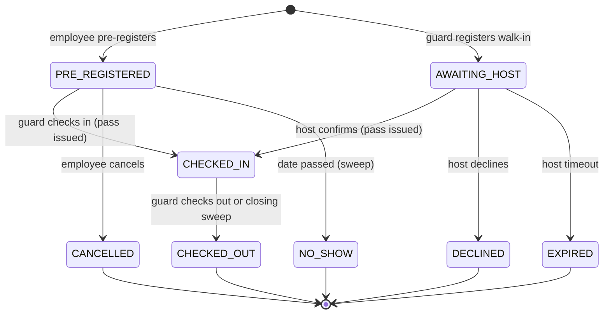

# School Visitor Management — Product Spec

Status: v1.1 (as built). v1.0 was written before the build; v1.1 aligns the data model with `backend/src/db/schema.sql` and adds the API (section 6). Decision trail: `decisions.md` (D1–D32). Permissions: `RBAC.md`. Assumptions: `assumptions.md`.

Business readers: sections 1–5, 7, 9–12. Developers: sections 4–8 (section 6 has the data model and API), 10 and the decision log.

## 1. Goals, out of scope, success measures

**Problem.** Visitors sign a paper logbook and get a numbered lanyard. Unannounced visitors wait at the gate while the guard phones around for the host. Some visitors never sign out, so departure times are missing, and nobody can say how many visitors are on campus right now.

**Goals**
1. Employees tell the gate ahead of time who is coming (pre-registration).
2. Unannounced visitors (walk-ins) reach the right employee within seconds, and are admitted only after that employee confirms.
3. Every visit leaves a trustworthy record: who came, who they saw, when they arrived and left.
4. The principal can see who is on campus now, including overstays.
5. Personal data is minimised, protected and retained for a limited time.

**Out of scope (this release)**: multiple schools/tenants; visitor profiles and a do-not-admit list; group or recurring visits; visitor self-service kiosk; real email/SMS providers; tracking the physical lanyard; escalation of unanswered host requests; guard override of an unconfirmed visitor; emailing passes or arrival codes to visitors; read-access logging.

**How the school knows it works**

| Measure | Target |
|---|---|
| Visits with a recorded arrival and an outcome | 100% |
| Visits with a verified (not system-assumed) departure | ≥ 90% after 4 weeks |
| Time from walk-in registration to host notification | < 10 s |
| Walk-ins answered by the host before timeout | ≥ 80% |
| "On campus now" count matches a gate walk-through | exact, at any time |
| Guard actions (check-in, walk-in, check-out) | ≤ 3 clicks |

## 2. Users and roles

Single school (~150 employees, 40–80 visitors per school day). The visitor is **not a user**; they hold a pass.

| Role | Can | Cannot |
|---|---|---|
| Employee | Pre-register, edit and cancel own visitors; confirm or decline walk-ins that name them | See other employees' visits; check visitors in/out; see audit or admin screens |
| Front Desk (guard) | Check in pre-registered visitors; register walk-ins; check out; view who is on campus; correct an unverified departure | Confirm a walk-in on a host's behalf; manage users or roles; see the audit trail |
| Admin | View everything read-only (live view, audit trail, sent messages); manage users, roles and permissions; correct an unverified departure | Check visitors in or out |

Roles are data: admins can create custom roles and assign permissions from a fixed catalogue. The server checks permissions, never role names. Full table: `RBAC.md`.

## 3. User stories and acceptance criteria

Priority: M = Must, S = Should (see section 12). IDs are used in `test-plan.md`.

### US-1 (M) Employee pre-registers a visitor
- **AC-1.1** Given I am an employee, when I submit name, purpose, date (today to +30 days), arrival window and duration, then a visit is created as `PRE_REGISTERED` with me as host.
- **AC-1.2** Given a date in the past or beyond 30 days, when I submit, then it is rejected with a clear message and nothing is saved.
- **AC-1.3** Given my `PRE_REGISTERED` visit, when I edit or cancel it, then it is updated or becomes `CANCELLED`; after check-in it can no longer be edited or cancelled.
- **AC-1.4** Given I am not the host of a visit, when I request or modify it, then the server refuses (404/403).

### US-2 (M) Front desk checks in a pre-registered visitor
- **AC-2.1** Given today's expected visitors, when I search by visitor or host name, then I see only today's `PRE_REGISTERED` visits.
- **AC-2.2** Given a `PRE_REGISTERED` visit for today, when I check it in, then it becomes `CHECKED_IN` and a pass (number and token) is issued.
- **AC-2.3** Given a visit that is cancelled, for another day, or already checked in, when I try to check it in, then it is rejected.
- **AC-2.4** Given a visitor not on the list, when I find no match, then I use the walk-in flow.

### US-3 (M) Front desk registers a walk-in
- **AC-3.1** Given a visitor without a pre-registration, when I enter name, purpose and pick a host, then a visit is created as `AWAITING_HOST` and no pass exists.
- **AC-3.2** Given an open visit with the same visitor name and host today, when I register, then I get a duplicate warning and may continue after confirming.
- **AC-3.3** Given a deactivated or non-host employee, when I pick the host, then the server rejects it.

### US-4 (M) Host is notified and confirms or declines
- **AC-4.1** Given a new `AWAITING_HOST` visit, then the host sees an in-app notification within the polling interval, and a simulated email and SMS record is written.
- **AC-4.2** Given I am the named host, when I confirm, then the visit becomes `CHECKED_IN` and a pass is issued.
- **AC-4.3** Given I am the named host, when I decline (optional reason), then the visit becomes `DECLINED`, no pass exists, and the guard sees the reason.
- **AC-4.4** Given I am not the named host, when I confirm or decline, then the server refuses.
- **AC-4.5** Given the visit is no longer `AWAITING_HOST`, when I confirm or decline, then the request is rejected with "visit already changed".
- **AC-4.6** Given email or SMS fails, then the failure is recorded and the in-app notification still stands.

### US-5 (M) Check-out
- **AC-5.1** Given a `CHECKED_IN` visit, when the guard enters the pass number or token, then the visit becomes `CHECKED_OUT` with the departure time, and the pass is invalid.
- **AC-5.2** Given a pass of a checked-out, expired, or unknown visit, when it is entered, then it is rejected and the attempt is audited.

### US-6 (S) Host does not respond
- **AC-6.1** Given an `AWAITING_HOST` visit, when half the timeout passes with no answer, then the host gets one reminder (in-app and simulated SMS).
- **AC-6.2** Given an `AWAITING_HOST` visit, when 5 minutes (configurable) pass without an answer, then it becomes `EXPIRED` and the guard sees "no response".
- **AC-6.3** Given an `EXPIRED` visit, when the host tries to confirm, then it is rejected; the guard can re-register the visitor.

### US-7 (S) Live on-campus view
- **AC-7.1** Given visitors are `CHECKED_IN`, when an authorised user opens the view, then it lists exactly them with host, check-in time and expected end.
- **AC-7.2** Given a `CHECKED_IN` visit past its expected end, then it is flagged "overstayed".
- **AC-7.3** Given a user without `visit:view_all`, then the endpoint refuses.

### US-8 (S) Closing-time sweep and departure correction
- **AC-8.1** Given visits still `CHECKED_IN` at closing time, when the sweep runs, then each becomes `CHECKED_OUT` with the closing time as departure, marked "departure unverified", and the pass is invalid.
- **AC-8.2** Given an unverified departure, when an authorised user enters a real time (not before check-in, not in the future), then it is corrected and the original value stays in the audit trail.
- **AC-8.3** Given `PRE_REGISTERED` visits for a past date, when the sweep runs, then they become `NO_SHOW`.

### US-9 (S) Audit trail
- **AC-9.1** Given any visit state change, notification outcome, login, or user/role/permission change, then an audit event with actor, action, target and time is stored.
- **AC-9.2** Given an audit event, then the application cannot update or delete it.
- **AC-9.3** Given a user without `audit:view`, then the endpoint refuses.

### US-10 (M) Users, roles and permissions
- **AC-10.1** Given an admin, when they create a user or role and assign permissions, then the server uses them on the next request.
- **AC-10.2** Given any endpoint, when a caller lacks the permission, then 403 regardless of the UI.
- **AC-10.3** Given the Admin role, then `user:manage` and `role:manage` cannot be removed, and seeded roles cannot be deleted.
- **AC-10.4** Given repeated failed logins, then login is rate-limited.

### US-11 (S) Printable pass
- **AC-11.1** Given a `CHECKED_IN` visit, then a print-friendly pass shows visitor, host, date, pass number and QR code (token), and no contact number.

### US-12 (S) Data retention
- **AC-12.1** Given visits older than the retention period (1 year), when the job runs, then name and contact are cleared and an audit event is written; timestamps, host, purpose and status remain.

## 4. Visit lifecycle



Terminal states: `CHECKED_OUT`, `DECLINED`, `EXPIRED`, `CANCELLED`, `NO_SHOW`. Overstay is derived (`CHECKED_IN` and now > expected end). One domain state machine is the only code allowed to change a visit's state; every other transition is rejected and unit-tested. All state changes are conditional updates in one transaction (first writer wins).

## 5. Flows

**Main A — pre-registered**: employee pre-registers → visitor arrives → guard searches today's list → check in → pass printed → … → guard checks out by pass number or QR.

**Main B — walk-in**: guard registers visitor and picks host → host notified → host confirms → pass issued → … → check-out.

**Alternatives and failures**

| Situation | Behaviour |
|---|---|
| Host declines | `DECLINED`, reason shown to guard; new registration needed to retry |
| Host silent | Reminder at half time, `EXPIRED` at full time; guard re-registers or picks another host |
| Late confirm after expiry, or two guards at once | Rejected: "visit already changed" |
| Pre-registered visitor arrives on a different day | Not in today's list → walk-in |
| Visitor not found by search | Walk-in |
| Duplicate open visit (same name and host) | Warning; guard may continue |
| Email/SMS channel fails | Failure recorded; in-app stands; no retry (future work) |
| Visitor leaves without checking out | Closing sweep: `CHECKED_OUT`, closing-time departure, "unverified" |
| Used or stale pass presented | Rejected; attempt audited |
| Poll misses an event | Next poll returns current state |
| Employee deactivated | Cannot log in or be chosen as host |
| Session expired | Redirected to login; no data shown |

## 6. Data model and API

### Data model

Source of truth: `backend/src/db/schema.sql`.

```
users(id, email unique (case-insensitive), name, password_hash, role_id, active, mobile null, created_at)
roles(id, name unique, system bool)
permissions(id, code unique)            -- seeded catalogue
role_permissions(role_id, permission_id)
sessions(id, user_id, created_at, expires_at, revoked_at)

visits(id, visitor_name null, visitor_contact null, purpose, host_id, created_by,
       kind (PRE_REGISTERED | WALK_IN), state, expected_date, window_start, window_end,
       duration_minutes, expected_end_at, registered_at, checked_in_at, checked_out_at,
       departure_verified, checked_out_by, departure_corrected_by, departure_corrected_at,
       decided_at, decline_reason, reminder_sent_at, anonymised_at)
passes(id, visit_id unique, number unique, token unique, issued_at, invalidated_at)

notifications(id, visit_id, recipient_id, channel (IN_APP | EMAIL | SMS),
              kind (WALK_IN_REQUEST | REMINDER | OUTCOME), message, status (SENT | FAILED),
              error, created_at, read_at)
audit_events(id, at, actor_id null, actor_label, action, target_type, target_id, details jsonb)  -- insert/select only
settings(key, value)                    -- timeout, closing time, retention, default duration
```

`visitor_name` is nullable only so that retention can clear it; the API requires it. There is no version column: concurrency is handled by the conditional update on `state` (D23). Check constraints restrict `state`, `kind`, `channel` and `status` to the listed values.

Indexes on `visits(state)`, `visits(expected_date)`, `visits(host_id)`, `notifications(recipient_id, channel)`, `audit_events(at)`, plus the unique constraints above. Timestamps are UTC; the school time zone is `Asia/Manila`.

### API

REST over JSON, prefix `/api`, served by the backend and proxied by the frontend so the session cookie (`sid`, httpOnly, SameSite=Lax) is same-origin. Every route needs a valid session except `health` and `auth/login`. "Permission" lists the permissions that each allow the call (any one is enough). Ownership rules (own visits, named host) are checked in the service. Request bodies are validated with zod (`backend/src/controllers/dto.ts`).

| Method and path | Permission | Purpose | Notable responses |
|---|---|---|---|
| `GET /health` | public | Liveness | 200 |
| `POST /auth/login` | public | `{email, password}` → user and permissions; sets the cookie | 401 bad credentials or inactive; 429 rate-limited |
| `POST /auth/logout` | signed in | Revokes the session | 204 |
| `GET /auth/me` | signed in | Current user and permissions | 401 |
| `POST /visits` | `visit:preregister` | Pre-register `{visitorName, visitorContact?, purpose, date, windowStart?, windowEnd?, durationMinutes?, hostId?}`. `hostId` defaults to the caller; the UI never sends it (A4) | 201; 400 `INVALID_DATE`, `INVALID_WINDOW`, `INVALID_HOST`, validation |
| `GET /visits/mine` | `visit:preregister` or `visit:host` | Visits I registered or host | 200 |
| `PATCH /visits/:id` | `visit:preregister` | Edit my pre-registration (same fields, all optional) | 404 not mine; 409 `VISIT_ALREADY_CHANGED` after check-in |
| `POST /visits/:id/cancel` | `visit:preregister` | Cancel my pre-registration | 404; 409 `VISIT_ALREADY_CHANGED` |
| `GET /visits/expected?q=` | `visit:checkin` | Today's `PRE_REGISTERED` visits, search by visitor or host | 200 |
| `POST /visits/:id/check-in` | `visit:checkin` | Check in a pre-registered visit; issues the pass | 409 `NOT_TODAY`, `VISIT_ALREADY_CHANGED` |
| `POST /visits/walk-in` | `visit:checkin` | Register a walk-in `{visitorName, visitorContact?, purpose, hostId, confirmDuplicate?}`; notifies the host | 201; 400 `INVALID_HOST` (inactive or cannot host); 409 `DUPLICATE_WARNING` (resend with `confirmDuplicate: true`) |
| `GET /visits/awaiting` | `visit:checkin` or `visit:view_all` | Walk-ins waiting for the host | 200 |
| `GET /visits/outcomes` | `visit:checkin` or `visit:view_all` | Today's walk-ins that were declined (with reason) or expired | 200 |
| `POST /visits/:id/respond` | `visit:host` | `{decision: confirm \| decline, reason?}` by the named host | 403 not the host; 409 `VISIT_ALREADY_CHANGED` (including after timeout) |
| `POST /visits/check-out` | `visit:checkout` | `{code}`: pass number or QR token; invalidates the pass | 404 unknown pass; 409 `PASS_NOT_VALID`; both audited |
| `POST /visits/:id/correct-departure` | `visit:correct_departure` | `{departedAt}` (ISO time) for a system-assumed departure | 400 before check-in or in the future; 409 `NOT_CORRECTABLE` (not a system-assumed departure) |
| `GET /visits/:id/pass` | `visit:checkin` or `visit:view_all` | Printable pass data (no contact number) | 409 `NO_VALID_PASS` |
| `GET /visits/on-campus` | `visit:view_all` | Live view: `{count, overstayedCount, visits}`, each with a derived `overstayed` flag | 200 |
| `GET /visits/history` | `audit:view` | Recent visits, all states | 200 |
| `GET /hosts` | `visit:preregister` or `visit:checkin` | Active employees who can host | 200 |
| `GET /notifications` | `visit:host` or `visit:preregister` | My in-app inbox | 200 |
| `POST /notifications/:id/read` | `visit:host` or `visit:preregister` | Mark read | 204 |
| `GET /messages` | `messages:view` | Simulated email/SMS log, including failures | 200 |
| `GET /audit?action=&targetId=` | `audit:view` | Audit trail | 200 |
| `GET /admin/users`, `POST /admin/users`, `PATCH /admin/users/:id` | `user:manage` | List, create, update (name, role, active, mobile, password) | 409 `EMAIL_TAKEN`, `LAST_ADMIN` |
| `GET /admin/roles` | `role:manage` or `user:manage` | Roles with permissions | 200 |
| `GET /admin/permissions` | `role:manage` | The fixed catalogue | 200 |
| `POST /admin/roles`, `PUT /admin/roles/:id/permissions`, `DELETE /admin/roles/:id` | `role:manage` | Create, set permissions, delete | 409 `ROLE_EXISTS`, `ADMIN_PROTECTED`, `SYSTEM_ROLE`, `ROLE_IN_USE`, `LAST_ADMIN` |

Application errors share one shape: `{code, message}` with extra fields where useful (e.g. `existingVisitId`); a malformed `:id` is rejected by NestJS's UUID pipe with its default 400 body. 401 means not signed in or session expired; 403 means the permission or ownership check failed; 404 is also returned for another employee's visit, so the API does not reveal that it exists.

## 7. Notifications

| Channel | Used for | Failure |
|---|---|---|
| In-app (always on) | Walk-in request to host; reminder; outcome to guard (via polling) | n/a |
| Email (simulated) | Walk-in request; reminder | Recorded as `FAILED`, in-app stands |
| SMS (simulated) | Reminder at half timeout | Recorded as `FAILED`, in-app stands |

Channels sit behind a `NotificationChannel` interface so a real provider can replace a simulator. Simulators write to `notifications` and show on the admin sent-messages screen; a config flag forces failures for testing.

Content (walk-in request): "[Visitor name] is at the gate to see you about [purpose]. Confirm or decline within [N] minutes." Reminder: "Reminder: [Visitor name] is still waiting at the gate."

## 8. Non-functional requirements

- **Security**: passwords hashed (argon2/bcrypt); server-side sessions in an httpOnly, SameSite cookie; login rate-limited; every endpoint authorises by permission; input validated; parameterised queries; secrets via environment; fictional data only; dependency audit in CI.
- **Auditability**: append-only `audit_events` (DB user has insert/select only) covering visit state changes, notification outcomes, logins, user/role/permission changes.
- **Front-desk performance**: single screen; ≤ 3 clicks per common action; API p95 < 300 ms at expected load; polling interval ~5 s.
- **Privacy (RA 10173)**: collect only name, purpose, host, optional contact; no ID numbers or photos; privacy notice at registration; role-based access to visitor data; records older than 1 year are anonymised by a scheduled job.
- **Reliability**: jobs are idempotent; transitions are atomic; timestamps from an injected clock.
- **Operability**: `docker compose up` runs everything; migrations and seed on start.

## 9. Assumptions

Summarised here and detailed (reasoning and impact) in `assumptions.md`. The ones that shape the design: single school; visitor is not a user; guard does check-out; pass issued only after check-in/confirmation; closing-time sweep with unverified departure; 5-minute host timeout; 1-year retention; Manila time zone; polling rather than push.

## 10. Key decisions and trade-offs

| Decision | Chosen | Rejected | Why |
|---|---|---|---|
| Stack | NestJS + Next.js/React + PostgreSQL | Spring Boot + Angular (suggested) | Author fluency in TypeScript; one language end to end; same Docker-based run |
| Permissions | Data-driven roles with fixed permission catalogue, custom roles | Hard-coded roles; per-user grants | Flexible for the school without per-user complexity |
| Auth | Server-side sessions in Postgres | JWT | Role changes and revocation apply immediately |
| Live updates | Polling (~5 s) | SSE, WebSockets | Simplest to test and run; ample for 40–80 visits/day |
| Overstay | Derived flag | Stored state | No job can leave it inconsistent |
| Host timeout | Expire after N minutes | Guard override, escalation | Never admits an unconfirmed visitor |
| Forgotten check-out | Closing-time auto check-out, marked unverified | Blank departure; none | Correct headcount without pretending the time is verified |
| Pass | Short number plus random token | Number only; physical lanyard pool | Typeable and unforgeable |
| Visitors | Per-visit data, no profiles | Visitor table | Simple retention; profiles are future work |
| Concurrency | Conditional update in one transaction | Version column; ignore | First writer wins; easy to test |
| Retention | Anonymise after 1 year | Delete; keep forever | Keeps statistics and audit references |
| Tenancy | Single school | Multi-tenant | Not required by the client; reduces risk |

## 11. Risks

| Risk | Mitigation |
|---|---|
| Hosts do not respond in time, gate queues form | Reminder, 5-minute expiry, clear guard message; escalation is future work |
| Guards bypass the system | Fast single screen, ≤ 3 clicks; admin sees counts |
| Unverified departures degrade the record | Marked and counted separately; correction path |
| Privacy complaint or data leak | Data minimisation, permission checks, anonymisation, audit |
| Permission misconfiguration by admins | Protected seeded roles, admin lockout guard, audited changes |
| Simulated notifications hide real-provider failures | Interface boundary and failure path tested; real provider is future work |
| Same-name visitors | Duplicate warning rather than blocking |
| Time or clock errors around the sweep | UTC storage, fixed Manila zone, injected clock tests |

## 12. Scope and priorities

Ranking (Must before Should; Should before Could):

| Capability | Priority | Reason |
|---|---|---|
| Pre-register a visitor | Must | Core request from the school |
| Check in and issue a pass | Must | Core gate flow |
| Register a walk-in naming a host | Must | Today's biggest pain |
| In-app notification to host | Must | Replaces phoning around |
| Host confirms/declines; pass only after confirmation | Must | Core safety rule |
| Check-out invalidates the pass | Must | Trustworthy record |
| Server-side role-based access | Must | Required by the exam and by privacy |
| User directory, roles and permissions table | Must | Author requirement; makes RBAC data-driven |
| Timeout outcome | Should | Defined outcome, built right after the Musts |
| Live on-campus view with overstays | Should | Answers the principal's question |
| Audit trail | Should | Trust, built right after the Musts |
| QR / printable pass | Should | Raised from Could by the author |
| CI pipeline | Should | Guardrail |
| Multi-tenant | Not built | Single school |

Built in this exam: all Musts, then Shoulds in the order above (timeout, live view, audit trail, printable pass, CI, sweep, retention).
A full production release would add: real email/SMS with retries, escalation, visitor profiles and do-not-admit, group and recurring visits, kiosk, SSO with the school directory, backups and monitoring, DPO-reviewed retention, multi-tenancy.
